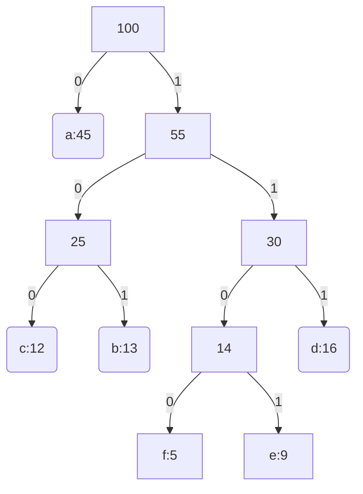

# Código de Huffman

> Técnica de compressão de dados (economia de 20% a 90%, dependendo do arquivo a ser comprimido).
> O algoritmo guloso de Huffman usa uma tabela de frequência de caracteres para obter um código binário único (códigoprefixo) de cada caracter encontrado no arquivo de entrada.

## Problema da codificação: 
> Dadas as frequências de ocorrências dos caracteres de um arquivo, encontrar a sequência de bits (códigos) para representá-los de modo que o arquivo comprimido tenha tamanho mínimo.

## Códigos livres de prefixos: 
> O código de um símbolo não é prefixo do código de nenhum outro símbolo.
> Códigos livres de prefixos são fáceis de decodificar.

## Exemplo:
### Tabela:

Parâmetros | a | b | c | d | e | f |
| --- | --- | --- | --- | --- | --- | --- |
Frequência | 45 | 13 | 12 | 16 | 9 | 5 |
Código de tamanho fixo | 000 | 001 | 010 | 011 | 100 | 101 |
Código de tamanho variável | 0 | 101 | 100 | 111 | 1101 | 1101 |

(Substitui no texto a letra pelo codigo de tamanho variável)

------
### Árvore de Huffman:

------
### Cálculo de Bits:

a = 45 · 1 = 45
---
b = 13 · 3 = 39
---
c = 12 · 3 = 36
---
d = 16 · 3 = 48
---
e = 9 · 4 = 36
---
f = 5 · 4 = 20
---

Custo total: B(T) = 254 bits
---

## Construindo o código de Huffman:
> Entrada: Conjunto de caracteres 'C' com as frequências 'f' dos caracteres em 'C'.
> Saída: raíz da árvore binária representando uma codificação ótima livre de prefixos.

