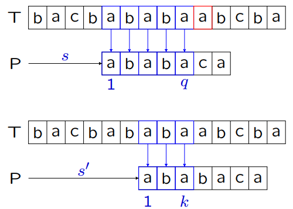

# Casamento de Padrões

O casamento de padrões é uma busca por uma cadeia de símbolos em uma sequência maior.

> Ex: Busca de palavras em texto.

##### Algoritmos

- string matching
- string searching
- pattern matching

##### Aplicações

- Busca de DNA
- Detecção de plágio
- Correção ortográfica
- Casamento de áudio

##### Casamento exato de padrões:

- Força bruta
- KMP
- Algoritmo Z
- Aho Corasick
- Boyer Moore

##### Casamento aproximado de padrões:
- Distância de Levenshtein

--- 

Seja T[1 . . n] um texto de tamanho n e P[1 . . m] um padrão de tamanho m, com m ≤ n. Os elementos de T e P são símbolos do alfabeto finito Σ.

> Exemplos:
- Σ = {0, 1}
- Σ = {a, b, . . . , z}

Dizemos que o padrão P ocorre em T, quando existir algum inteiro s ≤ n − m, tal que T[s + j] = P[j], 1 ≤ j ≤ m.

Se P ocorre com deslocamento s em T, então chamamos s de deslocamento válido; caso contrário chamamos de deslocamento inválido.

> Exemplo:

Texto T

|  1 | 2 | 3 | 4 | 5 | 6 | 7 | 8 | 9 | 10 | 11 | 12 |
| ;---; | ;---; | ;---; | ;---; | ;---; | ;---; | ;---; | ;---; | ;---; | ;---; | ;---; | ;---; | ;---; |
| a | b | c | a | b | a | a | b | c | a | b | a | 

Padrão P

|  1 | 2 | 3 | 4 |
| ;---; | ;---; | ;---; | ;---; |
| a | b | a | a | 

> Os deslocamentos s = 0, s = 1 e s = 2 são inválidos!
> O deslocamento s = 3 é válido!

O problema do casamento de padrões é o problema de encontrar
todos os deslocamentos válidos com os quais um dado padrão
P ocorre em um dado texto T.

> Exemplo: 

Texto T

| 1 | 2 | 3 | 4 | 5 | 6 | 7 | 8 | 9 | 10 | 11 |
| ;---; | ;---; | ;---; | ;---; | ;---; | ;---; | ;---; | ;---; | ;---; | ;---; | ;---; | ;---; |
| a | b | r | a | c | a | d | a | b | r | a | 

Padrão P

|  1 | 2 | 3 |
| ;---; | ;---; | ;---; |
| b | r | a | 

> No exemplo, P ocorre duas vezes em T, com s = 1 e s = 8.

## Notação e Terminologia

- **Definição 1.** O conjunto de todas as palavras de tamanho finito utilizando os símbolos do alfabeto Σ é denotado por Σ∗.

- **Definição 2.** O tamanho de uma palavra x é o número de símbolos dessa palavra e é denotado por |x|.

- **Definição 3.** A concatenação de 2 palavras x e y, denotada por xy, tem tamanho |x| + |y| e consiste dos símbolos de x seguidos dos símbolos de y.

> Exemplo:
- x = abc, |x| = 3
- y = aad, |y| = 3

> xy = abcaad, |xy| = |x| + |y| = 6

- **Definição 4 (Prefixo).** X[1 . . k] é prefixo de Y [1 . . j] se k ≤ j e X[1 . . k] = Y [1 . . k].

> Exemplo:
$$
\begin{cases}
X = abcdab \\
W = ab
\end{cases}
$$

> W é prefixo de X.

- **Definição 5 (Prefixo próprio).** Se k < j, então X[1 . . k] é prefixo próprio de Y .

> Exemplo: W é prefixo próprio de X.

- **Definição 6 (Sufixo).** X[1 . . k] é prefixo de Y [1 . . j] se k ≤ j e X[1 . . k] = Y [j − k + 1 . . j].

> Exemplo:
$$
\begin{cases}
X = abcdab \\
W = dab
\end{cases}
$$
> W é sufixo de X.

- **Definição 7 (Sufixo próprio).** Se k < j, então X[1 . . k] é sufixo próprio de Y .

> Exemplo: W é sufixo próprio de X.

## Força Bruta

O algoritmo de casamento de padrão utilizando o método da força bruta busca todos os deslocamentos válidos utilizando um laço que verifica a condição P[1 . . m] = T[s+1 . . s+m] para cada um dos n − m valores possíveis de s.

```
Força Bruta(T, P)
    n ← |T|
    m ← |P| 
    c ← 0
    para s ← 0 até n − m
        j ← 1
        enquanto j ≤ m e P[j] = T[s + j]
            j ← j + 1
        se j > m
            c ← c + 1
    retorne c
```

> Consumo de tempo: O(mn)

> Notas do João: de acordo com o exemplo é o seguinte, ele vai verificar o primeiro caracter do Padrão com as 'letras', caso ela bata com alguma (seja igual) ela vê a proxima letra depois dela do padrão e do texto, caso em qualquer momento não bata, ele passa pro proximo letra do texto e reinicia a do padrão para a primeira

### Problema da Força Bruta

Com o algoritmo de força bruta, o segundo caracter depois que o primeiro bater será testado duas vezes.

Mas sabemos que caracter é esse e que ele não aparece no padrão.

Vamos ver a seguir um algoritmo mais eficiente.

## Knuth Morris e Pratt (KMP)

- Criado por Donald Knuth, James Morris e Vaughan Pratt.
- O algoritmo KMP é baseado em uma pré-computação de uma função de prefixo para o padrão P.

> Suponha que os símbolos do padrão P[1 . . q] casam com os símbolos T[s + 1 . . s + q] do texto, mas P[q + 1] ̸= T[s + q + 1].


> Pergunta: Qual é o menor deslocamento s′ > s tal que
P[1 . . k] = T[s′ + 1 . . s′ + k], onde s′ + k = s + q?



- Na prática, o deslocamento s′ pode ser pré-computado comparando P com ele mesmo.
- Observe T[s′+1 . . s′+k] é um texto conhecido, e é um sufixo de P[1 . . q].
- Encontrar o menor deslocamento s′ > s, é o mesmo que encontrar o maior k < q, tal que, P[1 . . k] é sufixo de P[1 . . q].

Dado um padrão P[1 . . m], a função de prefixo para o padrão P é a função π : {1, 2, 3 . . . , m} → {0, 1, 2, . . . , m − 1} tal que

```π[q] = {k : k < q e P[1 . . k] é sufixo próprio de P[1 . . q]}```

Ou seja, π[q] é o tamanho do maior prefixo de P que é um sufixo de P[1 . . q]

> Exemplo: P = ababbababba

| q | 1 | 2 | 3 | 4 | 5 | 6 | 7 | 8 | 9 | 10 | 11 |
| ;---; | ;---; | ;---; | ;---; | ;---; | ;---; | ;---; | ;---; | ;---; | ;---; | ;---; | ;---; |
| P | a | b | a | b | b | a | b | a | b | b | a | 
| π | 0 | 0 | 1 | 2 | 0 | 1 | 2 | 3 | 4 | 5 | 6 |

```
Computar-Função-Prefixo(P)
    m ← |P|
    π[1] ← 0
    k ← 0
    para q ← 2 até m
        enquanto k > 0 e P[k + 1] ̸= P[q]
            k ← π[k]
        se P[k + 1] = P[q]
            k ← k + 1
        π[q] ← k
    retorne π
```

> Computar-Função-Prefixo(): O(m)

```
Casamento-Padrões-KMP(T, P)
    n ← |T|
    m ← |P|
    π ← Computar-Função-Prefixo(P)
    q ← 0
    para 1 ← 1 até n
        enquanto q > 0 e P[q + 1] ̸= T[i]
            q = π[q]
        se P[q + 1] = T[i]
            q ← q + 1
        se q = m
            imprima "P ocorre em T com deslocamento: ", i − m
            q ← π[q]
```

> Casamento-Padrões-KMP(): O(n)

> Portanto, o tempo total do algoritmo é O(m + n)

