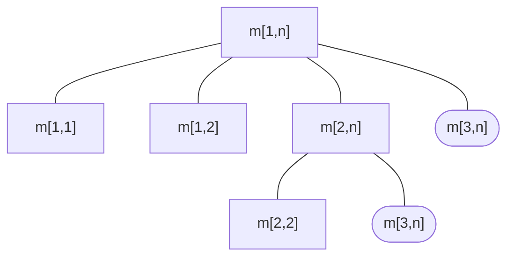

# Multiplicação de matrizes

## Problema: 

Multiplicar n matrizes realizando o número mínimo de operações.

```M = M_1 * M_2 * . . . M_n```

Como determinar a sequência ótima de multiplicação?
- Algoritmo força bruta é "impraticável": existem Ω(2n) possibilidades (número de Catalão)

Aplicando Programação dinâmica:
- É possível determinar uma sequência ótima eficiente (polinomial)

Para resolver este problema, tudo que precisamos é saber qual o melhor índice k tal que

```A = (A1 * A2 * · · · Ak) * (Ak+1 * Ak+2 * · · · An)```

> onde 'k' varia de '1' a 'n − 1'

Denotemos por **m[i, j]** o número mínimo de multiplicações necessárias para multiplicar **Ai · · · Aj, i ≤ j**. Temos que:

$$
m[i, j] = 
\begin{cases} 
0, & \text{se } i = j \\  
min{m[i, k] + m[k + 1, j] + p_i-1 * p_k * p_j}, & \text{se } i < j 
\end{cases}
$$

onde **p_0, p_1, · · · p_n** determinam as dimensões das matrizes: cada **A_i** tem dimensão **p_i−1 × p_i**.


## Algoritmo Recursivo

Entrada: **p_i−1 · · · p_j**
Saída: **m[i, j]**

```
cadeia-matriz-rec(p, i, j)
    se i = j então retorne 0
    m[i, j] = ∞
    para k = i até j − 1
        q = cadeia-matriz-rec(p, i, k) + cadeia-matriz-rec(p, k + 1, j) + p_i−1 * p_k * p_j
        se q < m[i, j]
            m[i, j] = q
    retorne m[i, j]
```

> O algoritmo recursivo para calcular m[i, j] por esta fórmula seria excessivamente lenta (exponencial)



Com a programação dinâmica é possível construir uma tabela para armazenar os valores de m[i, j] de forma bottom-up, usando memoização.
1. **m[i, i]** = 0, para **1 ≤ i ≤ n**.
2. **m[i, i + 1]** são calculados, para **1 ≤ i ≤ n − 1**.
3. **m[i, i + 2]** são calculados, para **1 ≤ i ≤ n − 2**.
4. e assim por diante

## Algoritmos Extras

### Ordem Cadeia Matriz

entrada: um vetor **p[0..n]** das dimensões das matrizes, e n o número de matrizes
saída: **m[1, n]** (solução ótima)

```
ordem-cadeia-matriz(p, n)
    para i = 1 até n faça m[i, i] = 0
    para l = 2 até n faça
        para i = 1 até n − l + 1 faça
            j = i + l − 1
            m[i, j] = ∞
            para k = i até j − 1 faça
                q = m[i, k] + m[k + 1, j] + p[i − 1]p[k]p[j]
                se q < m[i, j] então
                    m[i, j] = q
                    s[i, j] = k // usado para recuperar a parentização ótima
```

### Imprime Parenteses Otimo

```
imprime-parenteses-otimo(A, s, i, j)
    se i = j
        então imprime Ai
    senão
        imprime ”(”
        imprime-parenteses-otimo(A, s, i, s[i, j])
        imprime-parenteses-otimo(A, s, s[i, j] + 1, j)
        imprime ”)”
```

### Calcula Produto

```
calcula-produto(A, s, i, j)
    se i = j
        então retorne Ai
    senão
        X = calcula-produto(A, s, i, s[i, j])
        Y = calcula-produto(A, s, s[i, j] + 1, j)
        retorne multiplica(X,Y)
```